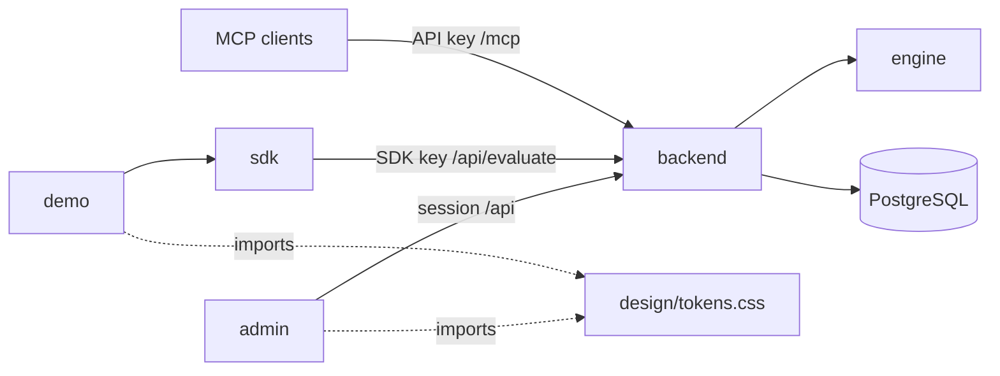
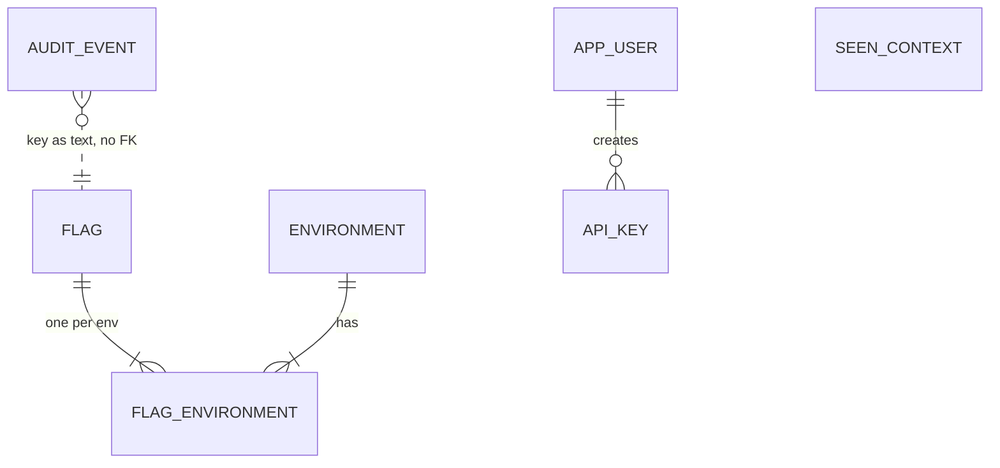

# Architecture Spine — feature-flags

Backfilled from the shipped code on 2026-11-25. `docs/plan.md` holds the full design (data model, API table, role matrix) and stays the source of truth; this spine keeps only the decisions new work must not break. All ADs are [ADOPTED]: existing reality settled them.

## Design Paradigm

A pure evaluation core with adapters around it. `engine/` is the core (JDK only, no I/O). `backend/` is a layered Spring app: controller (HTTP only) → service (logic, authorization, audit) → repository (DB only), with three inbound adapters onto the same services: REST with sessions (`/api`), evaluation with SDK keys (`/api/evaluate`, SSE), and MCP with API keys (`/mcp`). `admin/` and `demo/` are clients; `demo/` goes through `sdk/`.

## Invariants & Rules



### AD-1 — The engine is pure and JDK-only [ADOPTED]
- **Binds:** FR-5, FR-7; `engine/`
- **Prevents:** framework or I/O leaking into evaluation, making it untestable in isolation.
- **Rule:** no non-test dependencies (enforced by `maven-enforcer` in `engine/pom.xml`); no I/O, clock, randomness, logging or mutable static state; the engine never depends on `backend`.

### AD-2 — Open/closed targeting [ADOPTED]
- **Binds:** FR-4, FR-7
- **Prevents:** every new rule type or attribute touching the evaluator, context, mapper and API.
- **Rule:** a rule type is a new `Rule` class plus one JSON-type registration; each `RuleSpec` maps itself via `toEngineRule()`. New attributes go in `EvaluationContext.attributes`, never a new field.

### AD-3 — Bucketing is frozen [ADOPTED]
- **Binds:** FR-5
- **Prevents:** re-bucketing every user in production.
- **Rule:** murmur3_x86_32 of UTF-8 `flagKey + ":" + userId`, seed 0, unsigned mod 10 000, match when `bucket < percent * 100`. Golden vectors in `BucketingTest` are never edited. Changing any part needs explicit approval.

### AD-4 — One place decides authorization [ADOPTED]
- **Binds:** FR-8, FR-18, FR-19
- **Prevents:** permissions drifting between REST, MCP and the UI.
- **Rule:** services call `AccessPolicy`; controllers and tools don't decide. The UI enables controls only from `can` on `/api/auth/me`.

### AD-5 — Audit in the same transaction [ADOPTED]
- **Binds:** FR-9, FR-10
- **Prevents:** changes without a record, or records of changes that rolled back.
- **Rule:** every mutation writes its `audit_event` in the same transaction as the change, with the actor and an `AuditDiff` plain-words summary. Audit rows store the flag key as text (no FK) so they survive deletes.

### AD-6 — Evaluation returns results only [ADOPTED]
- **Binds:** FR-6, FR-15, FR-17
- **Prevents:** targeting lists reaching browsers through public SDK keys.
- **Rule:** `/api/evaluate` returns value, reason and at most the matched rule's index and kind. The SDK key decides the environment.

### AD-7 — MCP reuses the services [ADOPTED]
- **Binds:** FR-18, FR-19
- **Prevents:** agents and the dashboard behaving differently.
- **Rule:** tools call the same services as controllers and return the shared views (`FlagView`). Every dashboard action has a tool (`McpApiTest.everyDashboardActionIsATool`). API keys authenticate only on `/mcp`, sessions only on `/api`.

### AD-8 — Nulls stop at the boundary [ADOPTED]
- **Binds:** all
- **Prevents:** the `contains(null)` NPE class of bugs (hit three times).
- **Rule:** request records normalise in compact constructors; optional query params arrive as `Optional`; services, rules and repositories never receive null.

### AD-9 — Optimistic locking on flag environments [ADOPTED]
- **Binds:** FR-3, FR-4
- **Prevents:** silent overwrites between concurrent editors.
- **Rule:** rules are saved whole as one ordered JSONB array with `version`; a stale version is 409.

### AD-10 — Change events after commit [ADOPTED]
- **Binds:** FR-16, FR-17
- **Prevents:** clients refetching state that then rolls back.
- **Rule:** mutations that can change results publish `FlagChanged`; listeners act after commit only. Long-lived SSE responses close on shutdown (`ChangeStream.closeAll`).

### AD-11 — Append-only migrations [ADOPTED]
- **Binds:** all schema changes
- **Prevents:** diverging databases.
- **Rule:** committed Flyway migrations are never edited; changes are a new `V<n>__` file.

## Consistency Conventions

| Concern | Convention |
| --- | --- |
| Naming | Flag keys kebab-case (`^[a-z0-9][a-z0-9-]{0,62}$`); Java records for DTOs; one `api.ts` per frontend app |
| Errors | `ProblemDetail` (`application/problem+json`) with field-level messages, e.g. `rules[0].userIds[1]` |
| Validation | at the API boundary (`@Valid` + rule-shape checks); fail fast |
| Injection | constructor injection, depend on interfaces; no Lombok |
| Auth | session cookie + CSRF token on `/api`; `X-SDK-Key` on `/api/evaluate`; Bearer API key on `/mcp` |
| UI styling | colour only from semantic tokens in `design/tokens.css`; 4px spacing grid; contrast checked by `contrast.test.ts` |
| Tests | engine tests first; new HTTP behaviour gets an `ApiTest` on real Postgres; role changes get a `RoleMatrixApiTest` row |

## Stack

| Name | Version |
| --- | --- |
| Java | 21 |
| Spring Boot | 3.5.6 |
| PostgreSQL | 17 (alpine image) |
| MCP Java SDK | 2.2.0 |
| React | 18.3 |
| TypeScript | 5.8 |
| Vite | 6.3 |
| TanStack Query | 5.80 |
| Vitest | 3.2 |
| lucide-react | 1.61.0 (pinned) |

## Structural Seed



```text
feature-flags/
  engine/    # pure evaluation core
  backend/   # Spring Boot: access, apikeys, audit, auth, contexts, environments, evaluation, flags, mcp, web
  admin/     # React admin dashboard
  demo/      # React storefront, reads flags only via sdk/
  sdk/       # TS client SDK, no runtime deps
  design/    # shared tokens.css
  qa/        # Playwright runner for the top 25 QA cases
```

## Capability → Architecture Map

| Capability / Area | Lives in | Governed by |
| --- | --- | --- |
| FR-1 – FR-3 flags and environments | `backend/.../flags`, `environments` | AD-4, AD-5, AD-9 |
| FR-4, FR-7 rules | `engine/.../rules`, backend `RuleSpec` | AD-2, AD-8 |
| FR-5 evaluation | `engine/` `Evaluator`, `Bucketing` | AD-1, AD-3 |
| FR-6 evaluation API | `backend/.../evaluation` | AD-6 |
| FR-8 roles | `backend/.../access` (`AccessPolicy`) | AD-4 |
| FR-9, FR-10 audit and activity | `backend/.../audit`, `admin/src/ActivityPage.tsx` | AD-5 |
| FR-11 – FR-14 admin | `admin/` | AD-4, UI conventions |
| FR-13 seen IDs | `backend/.../contexts` | AD-8 |
| FR-15 – FR-17 storefront, live updates, SDK | `demo/`, `sdk/`, `ChangeStream` | AD-6, AD-10 |
| FR-18, FR-19 MCP and keys | `backend/.../mcp`, `apikeys` | AD-4, AD-7 |

## Deferred

- Caching and multi-instance fan-out (in-memory snapshot, Postgres `LISTEN/NOTIFY`): a single instance reads config per call, and that's enough today.
- Server-side SDK with local evaluation: needs a second, secret key type.
- MCP OAuth, per-key rate limits, finer scopes: static fixed-role keys suffice for the internal pilot.
- Generic attribute/operator rules: AD-2 already allows them; first candidate for the BMAD pilot feature.
