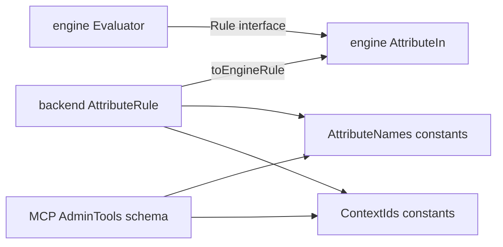

# Architecture Spine — attribute-rules

## Design Paradigm

Inherited unchanged: a pure engine rule plus a backend `RuleSpec` that maps itself; REST, MCP and evaluation reach it through the existing services.

## Inherited Invariants

| Inherited | From parent | Binds here |
| --- | --- | --- |
| AD-1 | architecture.md | `AttributeIn` is JDK-only and pure |
| AD-2 | architecture.md | no change to `Evaluator`, `EvaluationContext` or `EngineMapper`; new class + one `@JsonSubTypes` line |
| AD-4 | architecture.md | attribute rules go through `AccessPolicy` like every rule change: editors dev only, over REST and MCP |
| AD-6 | architecture.md | `/api/evaluate` exposes `ruleType: "attribute"` only, never the name or values |
| AD-7 | architecture.md | MCP `set_flag_rules` accepts the new type through the same services |
| AD-8 | architecture.md | the rule never receives null; absent attributes arrive as `Optional.empty()` |
| AD-11 | architecture.md | seed data goes in a new `V5__` migration |

## Invariants & Rules

### AD-12 — One engine rule with an operator [ADOPTED]

- **Binds:** CAP-1; `engine/.../rules/AttributeIn`
- **Prevents:** two rule classes drifting apart; a blank string matching `not in`.
- **Rule:** `AttributeIn(String attribute, Operator operator, Set<String> values, boolean serve)` with engine enum `Operator { IN, NOT_IN }`. The constructor rejects a blank name and empty or blank values. An absent or blank attribute value never matches, for both operators.

### AD-13 — JSON shape with a required operator [ADOPTED]

- **Binds:** CAP-1, CAP-2, CAP-3
- **Prevents:** the UI, agents and the API assuming different defaults.
- **Rule:** `{"type":"attribute","attribute":"country","operator":"in"|"not_in","values":["US","CA"],"serve":true}`. `operator` is required; `serve` defaults to ON like other rules. `describe()` gives "country in US, CA" / "country not in US", plus " (serves OFF)" when applicable.

### AD-14 — Shared validation constants [ADOPTED]

- **Binds:** CAP-1, CAP-3
- **Prevents:** REST and MCP accepting different names or values.
- **Rule:** `AttributeNames.PATTERN` = `^[a-z][a-z0-9_]{0,63}$` and `MESSAGE` live beside `ContextIds`; values use `ContextIds.PATTERN`. The MCP schema reads both constants, never literals.

### AD-15 — MCP schema covers every rule type [ADOPTED]

- **Binds:** CAP-3; `McpApiTest`
- **Prevents:** a future rule type missing from MCP's hand-written schema.
- **Rule:** a test asserts that every `RuleSpec` `@JsonSubTypes` name appears in the `set_flag_rules` input schema and in its unknown-type message.

### AD-16 — Audience wording [ADOPTED]

- **Binds:** CAP-2; `admin/src/audience.ts`
- **Prevents:** the admin describing attribute rules differently in different places.
- **Rule:** `in` → "users with country US or CA"; `not in` → "users whose country isn't US"; more than two values → "users with country in N values" (mirroring the existing `ids()` rule).

## Consistency Conventions

| Concern | Convention |
| --- | --- |
| Naming | engine `AttributeIn`, backend `AttributeRule`, JSON type `attribute`, admin draft type `attribute`, debug label "attribute" |
| Editor labels | operator select reads "is one of" / "is not one of"; accessible names follow the existing pattern, e.g. "Rule 1 attribute name", "Rule 1 values" |
| Errors | field errors name the path: `rules[0].attribute`, `rules[0].operator`, `rules[0].values[1]` |
| Demo data | fictional only: Ana US, Ben CA, Cy US, Dee DE, Eli and the anonymous visitor without a country; seed flag `free-shipping` with `country in [CA]` in prod, its own storefront block `data-flag="free-shipping"` |

## Deferred

- Seen-attribute suggestions and "never seen" warnings: the spec's non-goals; `seen_context` stays user/customer only.
- More operators: the `Operator` enum is the extension point when one is needed.
- Case-insensitive matching: revisit if real attribute sources send mixed case.
